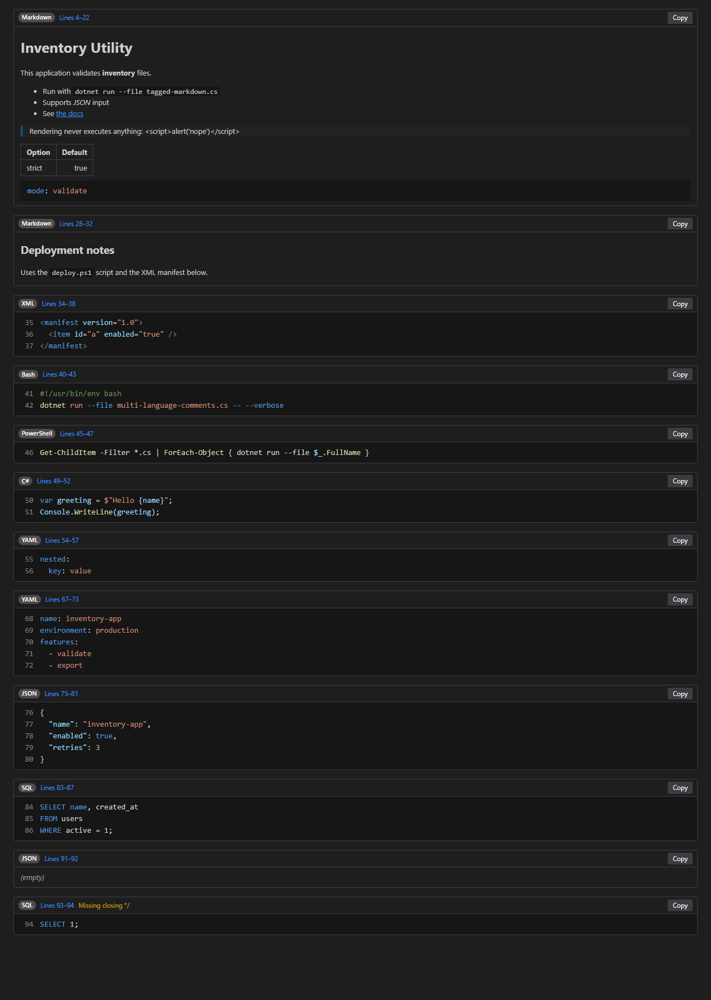
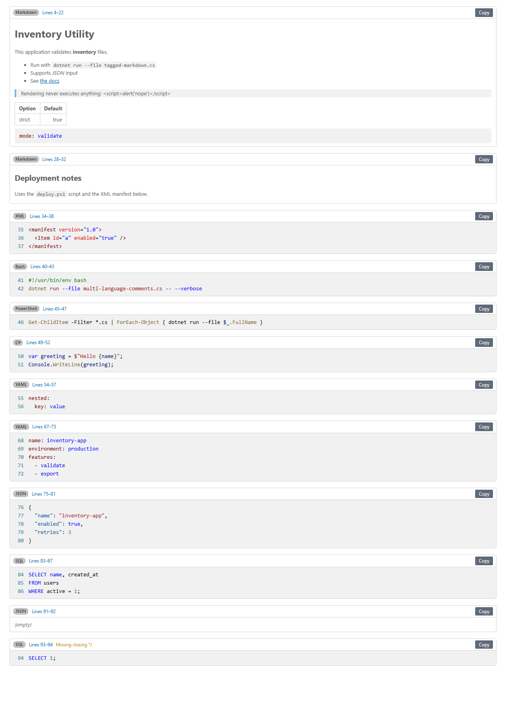

# .NET File Apps Toolkit

Run and manage .NET 10+ file-based apps directly from Visual Studio Code. The extension also recognizes explicitly tagged C# block comments and provides Markdown hover/preview and syntax highlighting for embedded code.

## Requirements

| Component | Requirement |
| --- | --- |
| Visual Studio Code | 1.100 or later |
| .NET SDK | 10.0.100 or later |
| Workspace | Trusted for commands that execute the .NET SDK |

The extension host must be able to access the `dotnet` executable. Set `dotnetFileAppsToolkit.dotnetPath` if it is not on `PATH`.

## .NET file-based apps

Create a standalone `.cs` file, for example:

```csharp
#:property PublishAot=false

Console.WriteLine("Hello from a file-based app!");
```

By default, the toolkit recognizes files beginning with `#:` directives or a `dotnet` shebang. The **File Detection** setting can also recognize standalone top-level C# files outside project folders, or restrict recognition to files you explicitly enable.

Use the editor title actions, Command Palette (`.NET File Apps`), or the commands below:

| Command | Operation |
| --- | --- |
| Run File | Run the selected file with `dotnet run --file` |
| Run with Arguments… | Run with separately parsed application arguments (no shell expansion) |
| Restore / Build / Clean File | Run the corresponding file-based .NET CLI operation |
| Publish Executable… | Publish to a selected output folder |
| Convert to Project… | Create a project folder and keep the original file unchanged |
| Check .NET SDK | Show the SDK selected for the file's folder |
| More Actions… | Open the file's action picker |

The toolkit prompts before saving unsaved changes by default. Published file-based apps use Native AOT by default; this requires the platform's native toolchain. Add `#:property PublishAot=false` to publish a framework-dependent app instead.

The `dotnet-file-app` task type is available for `tasks.json`:

```json
{
  "version": "2.0.0",
  "tasks": [
    {
      "type": "dotnet-file-app",
      "action": "build",
      "file": "${workspaceFolder}/hello.cs",
      "problemMatcher": []
    }
  ]
}
```

## Tagged comments

Only explicit `/*tag` block comments are interpreted; ordinary and XML documentation comments are left alone. Tags are case-insensitive.

```csharp
/*markdown
## Deployment

Run the **deploy** script after validating the configuration.
*/

/*yaml
environment: production
features:
  - validate
*/

/*json
{
  "enabled": true
}
*/
```

`/*markdown` supports a rendered hover and a full preview panel. Use **Preview Tagged Comments** from the editor or Command Palette to open the preview.

### Preview screenshots

| Dark theme | Light theme |
| --- | --- |
|  |  |

Supported tags and aliases:

| Language | Tags |
| --- | --- |
| Markdown | `markdown`, `md` |
| YAML | `yaml`, `yml` |
| JSON | `json` |
| SQL | `sql` |
| XML | `xml` |
| Bash | `bash`, `sh`, `shell` |
| PowerShell | `powershell`, `ps1` |
| C# | `csharp`, `cs` |
| JavaScript | `javascript`, `js`, `cjs`, `mjs` |
| TypeScript | `typescript`, `ts`, `cts`, `mts` |
| HTML | `html`, `htm` |
| CSS | `css` |
| Python | `python`, `py` |
| C++ | `cpp`, `c++`, `cxx` |
| TOML | `toml` |
| INI | `ini`, `cfg`, `conf` |
| Dockerfile | `dockerfile`, `docker` |
| CSV | `csv` |

The preview renders Markdown and syntax-highlighted code using bundled grammars for all listed code tags. In the native C# editor, VS Code's TextMate injection grammar provides embedded scopes when the corresponding language grammar is installed. Depending on the active C# semantic-highlighting provider and theme, color decorations may be used to restore code colors.

## Settings

| Setting | Default | Description |
| --- | --- | --- |
| `dotnetFileAppsToolkit.enabled` | `true` | Enable toolkit commands and editor actions. |
| `dotnetFileAppsToolkit.fileDetection` | `strict` | `strict`, `standalone`, or `manual` file-app detection. |
| `dotnetFileAppsToolkit.dotnetPath` | `dotnet` | .NET executable path used by the extension host (machine setting). |
| `dotnetFileAppsToolkit.autoSaveBeforeRun` | `prompt` | `prompt`, `always`, or `never` before CLI actions. |
| `dotnetFileAppsToolkit.run.args` | `[]` | Default Run File arguments; each entry is passed as one argument. |
| `dotnetFileAppsToolkit.comments.enabled` | `true` | Enable tagged-comment scanning, hover, decorations, and preview. |
| `dotnetFileAppsToolkit.comments.highlight.enabled` | `true` | Enable editor color and Markdown emphasis decorations. |
| `dotnetFileAppsToolkit.comments.highlight.strategy` | `auto` | `auto`, `injection`, `decorations`, or `off`. |
| `dotnetFileAppsToolkit.comments.markdown.hover` | `true` | Show rendered Markdown hover. |
| `dotnetFileAppsToolkit.comments.previewOnOpen` | `false` | Automatically open previews for files with tagged comments. |
| `dotnetFileAppsToolkit.comments.unknownTagDiagnostic` | `false` | Report unknown language tags as information diagnostics. |

## Compatibility and limitations

| Environment | Behavior |
| --- | --- |
| VS Code 1.100+ | Supported |
| .NET SDK 10.0.100+ | File-based app commands supported |
| .NET SDK 10.0.300+ | Adds the SDK's `#:include` support for source files |
| .NET SDK 11+ | Adds the SDK's `#:include` DLL and file-based `dotnet reference` command support |
| Windows, Linux, macOS | Covered by CI; the .NET SDK and platform requirements still apply |
| Remote workspace | Commands run through the extension host where `dotnet` is installed |
| Virtual workspace | Not supported for file-based app commands |

Additional notes:

- The TextMate injection grammar is a static VS Code contribution. It cannot be disabled by this extension's settings, including `comments.enabled`, `highlight.enabled`, and strategy `off`; those settings control the extension's own decorations and preview behavior.
- `auto` chooses injection for high-contrast themes and when semantic highlighting is disabled. When a C# semantic token provider is present, it may add bundled Light+/Dark+ color decorations. Those colors are not derived from every user's custom theme.
- Content on the same line as the closing `*/` is not included by the native injection grammar; the preview and decorations can still highlight it.
- The .NET SDK/MSBuild currently rejects some special characters in source file names, including `;`, `%`, and `'`. Spaces and Unicode names are supported; shell metacharacters are passed without shell expansion.
- Native AOT publishing needs a native toolchain (on Windows, Visual Studio's **Desktop development with C++** workload). Use `PublishAot=false` to avoid it.
- Running, building, publishing, and converting execute the .NET SDK and are unavailable in Restricted Mode. Review and trust a workspace before running its code.
- The preview sanitizes rendered content and only allows remote images in a trusted workspace.

## Development

```sh
npm ci
npm run lint
npm run check-types
npm run test:unit
npm run test:integration
npm run vsix
```

Linux integration tests require a display server such as Xvfb.

## License

[MIT](./LICENSE)
