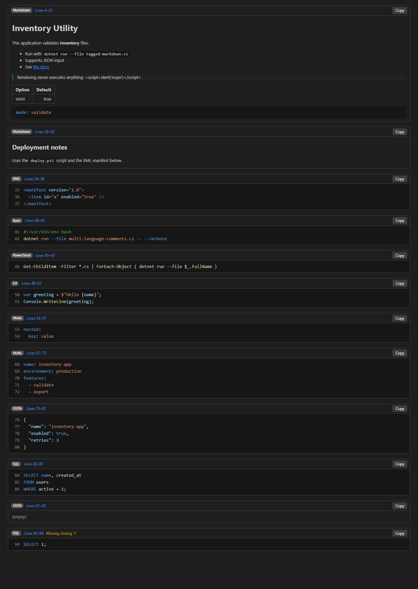
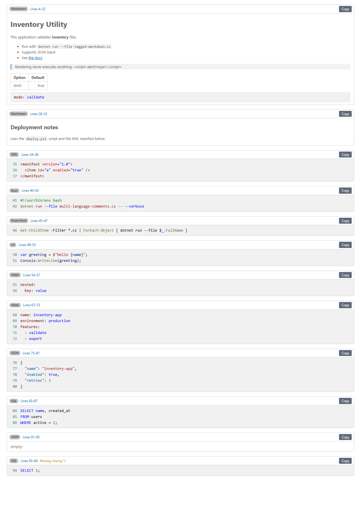

# .NET File Apps Toolkit

直接在 Visual Studio Code 執行及管理 .NET 10+ 檔案型應用程式。延伸模組也能辨識 C# 區塊註解中明確標記的語言，提供 Markdown 暫留提示／預覽，以及嵌入程式碼的語法醒目提示。

## 需求

| 元件 | 需求 |
| --- | --- |
| Visual Studio Code | 1.100 或更新版本 |
| .NET SDK | 10.0.100 或更新版本 |
| 工作區 | 執行會呼叫 .NET SDK 的命令前，必須信任工作區 |

延伸模組主機必須能存取 `dotnet` 執行檔。若它不在 `PATH` 中，請設定 `dotnetFileAppsToolkit.dotnetPath`。

## .NET 檔案型應用程式

建立獨立的 `.cs` 檔案，例如：

```csharp
#:property PublishAot=false

Console.WriteLine("Hello from a file-based app!");
```

預設會辨識以 `#:` 指示詞或 `dotnet` shebang 開頭的檔案。「檔案辨識」設定也能辨識專案資料夾以外、含最上層陳述式的獨立 C# 檔案，或限制為只辨識明確啟用的檔案。

使用編輯器標題列動作、命令選擇區（`.NET File Apps`）或下列命令：

| 命令 | 操作 |
| --- | --- |
| 執行檔案 | 使用 `dotnet run --file` 執行選取的檔案 |
| 帶參數執行… | 使用個別解析的應用程式參數執行（不進行 shell 展開） |
| 使用啟動設定檔執行… | 從 `Properties/launchSettings.json` 或 `<AppName>.run.json` 選取 `Project` 或 `Executable` 設定檔 |
| 還原／建置／清除檔案建置輸出 | 執行對應的檔案型 .NET CLI 操作 |
| 發佈可執行檔… | 發佈至選取的輸出資料夾 |
| 封裝為工具 | 將檔案封裝為 .NET 工具；`#:property PackAsTool=false` 會停用此動作 |
| 清理檔案型應用程式快取… | 確認後清理至少 30 天未使用的快取產物（預設值） |
| 管理檔案型應用程式指示詞… | 新增／更新 `#:package`，並檢視／編輯現有的 `#:sdk`、`#:property`、`#:project` 與 `#:include` 指示詞 |
| 管理專案參考… | 使用 .NET 11 SDK 或更新版本列出、新增或移除 `#:project` 參考 |
| 格式化檔案… | 使用 .NET 格式化工具格式化檔案型應用程式（需要 .NET 11 SDK 或更新版本） |
| 轉換為專案… | 建立專案資料夾並保留原始檔案 |
| 檢查 .NET SDK | 顯示此檔案資料夾所選用的 SDK |
| 更多動作… | 開啟檔案動作選單 |

預設會在儲存未儲存的變更前詢問。檔案型應用程式預設以 Native AOT 發佈，這需要平台原生工具鏈。若要改為發佈架構相依應用程式，請加入 `#:property PublishAot=false`。
指示詞編輯會在確認後直接套用至開啟中的文件；新增套件不會執行還原或執行應用程式。

`tasks.json` 可使用 `dotnet-file-app` 工作類型（`run`、`restore`、`build`、`clean`、`publish` 和 `pack`）：

```json
{
  "version": "2.0.0",
  "tasks": [
    {
      "type": "dotnet-file-app",
      "action": "build",
      "file": "${workspaceFolder}/hello.cs",
      "problemMatcher": []
    }
  ]
}
```

## 標記註解

只有明確使用 `/*tag` 的區塊註解會被解讀；一般註解與 XML 文件註解不受影響。標記不區分大小寫。

```csharp
/*markdown
## 部署

驗證設定後，執行 **deploy** 指令碼。
*/

/*yaml
environment: production
features:
  - validate
*/

/*json
{
  "enabled": true
}
*/
```

`/*markdown` 支援渲染後的暫留提示與完整預覽面板。可從編輯器或命令選擇區執行「預覽標記註解」。

### 預覽畫面

| 深色佈景主題 | 淺色佈景主題 |
| --- | --- |
|  |  |

支援的標記與別名：

| 語言 | 標記 |
| --- | --- |
| Markdown | `markdown`、`md` |
| YAML | `yaml`、`yml` |
| JSON | `json` |
| SQL | `sql` |
| XML | `xml` |
| Bash | `bash`、`sh`、`shell` |
| PowerShell | `powershell`、`ps1` |
| C# | `csharp`、`cs` |

預覽面板會渲染 Markdown，並為程式碼套用語法醒目提示。在原生 C# 編輯器中，VS Code 的 TextMate 注入文法會提供嵌入語法範圍；依使用中的 C# 語意醒目提示提供者與佈景主題，可能會另外套用顏色裝飾，以還原程式碼顏色，並讓 `/*markdown` 內容呈現類似 `.md` 檔案的配色（一般文字使用編輯器前景色，而非註解顏色）。

## 設定

| 設定 | 預設值 | 說明 |
| --- | --- | --- |
| `dotnetFileAppsToolkit.enabled` | `true` | 啟用工具組命令與編輯器動作。 |
| `dotnetFileAppsToolkit.fileDetection` | `strict` | 檔案型應用程式辨識方式：`strict`、`standalone` 或 `manual`。 |
| `dotnetFileAppsToolkit.dotnetPath` | `dotnet` | 延伸模組主機使用的 .NET 執行檔路徑（機器設定）。 |
| `dotnetFileAppsToolkit.autoSaveBeforeRun` | `prompt` | 執行 CLI 操作前的處理方式：`prompt`、`always` 或 `never`。 |
| `dotnetFileAppsToolkit.codeLens.enabled` | `false` | 在已辨識的檔案型應用程式頂端顯示「執行檔案」與「更多動作」CodeLens。 |
| `dotnetFileAppsToolkit.run.args` | `[]` | 執行檔案的預設參數；陣列中的每項會作為一個參數傳遞。 |
| `dotnetFileAppsToolkit.comments.enabled` | `true` | 啟用標記註解掃描、暫留提示、裝飾與預覽。 |
| `dotnetFileAppsToolkit.comments.highlight.enabled` | `true` | 啟用編輯器顏色與 Markdown 強調裝飾。 |
| `dotnetFileAppsToolkit.comments.highlight.strategy` | `auto` | 使用 `auto`、`injection`、`decorations` 或 `off`。 |
| `dotnetFileAppsToolkit.comments.markdown.hover` | `true` | 顯示渲染後的 Markdown 暫留提示。 |
| `dotnetFileAppsToolkit.comments.previewOnOpen` | `false` | 開啟含有標記註解的檔案時自動顯示預覽。 |
| `dotnetFileAppsToolkit.comments.unknownTagDiagnostic` | `false` | 將未知語言標記回報為資訊診斷。 |

## 相容性與限制

| 環境 | 行為 |
| --- | --- |
| VS Code 1.100+ | 支援 |
| .NET SDK 10.0.100+ | 支援檔案型應用程式命令 |
| .NET SDK 10.0.300+ | SDK 開始支援對原始程式檔使用 `#:include` |
| .NET SDK 11+ | SDK 開始支援 `#:include` DLL 與檔案型 `dotnet reference` 命令 |
| Windows、Linux、macOS | CI 涵蓋；仍須符合 .NET SDK 與平台需求 |
| 遠端工作區 | 命令會在安裝 `dotnet` 的延伸模組主機執行 |
| 虛擬工作區 | 不支援檔案型應用程式命令 |

其他注意事項：

- TextMate 注入文法是靜態的 VS Code 貢獻項目，無法透過本延伸模組設定停用，包括 `comments.enabled`、`highlight.enabled` 與策略 `off`；這些設定只控制延伸模組自己的裝飾與預覽行為。
- `auto` 在高對比佈景主題或停用語意醒目提示時使用注入文法。存在 C# 語意 token 提供者時，可能會加上內建的 Light+/Dark+ 顏色裝飾；這些顏色不會依所有自訂佈景主題調整。
- `/*markdown` 內容只有透過顏色裝飾才會呈現 `.md` 風格的配色（標題、強調、行內程式碼、連結、清單、引用、程式碼區塊與行內 HTML）：策略為 `decorations`，或 `auto` 且存在 C# 語意 token 提供者或 C# 擴充套件。否則內容維持註解顏色，只套用粗體、斜體、行內程式碼與連結強調（策略為 `off` 時則完全不套用）。
- 標記 JSON 的結構分隔符使用編輯器前景色，且匹配的 `{}`、`[]` 會套用佈景主題的括號配對色。此行為在 `injection` 策略也會生效，並遵循 `editor.bracketPairColorization.enabled`；不會改變註解內的 JSON 編輯行為。
- 原生注入文法不會標記與結尾 `*/` 同一行的註解內容；預覽及裝飾仍可醒目提示該內容。
- .NET SDK/MSBuild 目前不接受部分特殊檔名字元，包括 `;`、`%` 與 `'`。空格與 Unicode 檔名可用；shell 中繼字元會以不經 shell 展開的方式傳遞。
- Native AOT 發佈需要原生工具鏈（Windows 需要 Visual Studio「使用 C++ 的桌面開發」工作負載）。可用 `PublishAot=false` 避免此需求。
- 所有會啟動 .NET SDK 的命令（包括執行、建置、發佈、轉換、封裝工具、專案參考、格式化、快取清理與「**檢查 .NET SDK**」）在受限模式下都無法使用。MSBuild 檔案，以及以 `sdk.paths` 指向資料夾內 SDK 的 `global.json`，都可能執行工作區中的程式碼。受限模式下也會忽略工作區層級的 `dotnetPath` 與 `run.args` 設定。執行程式碼前請先檢視並信任工作區。
- 預覽會清理渲染內容，且只有在受信任的工作區中才允許載入遠端圖片。

## 開發

```sh
npm ci
npm run lint
npm run check-types
npm run test:unit
npm run test:integration
npm run vsix
```

Linux 整合測試需要 Xvfb 等顯示伺服器。`npm run test:integration` 會先執行主要測試，再以啟用工作區信任的受限模式執行另一組測試。

## 授權

[MIT](./LICENSE)
